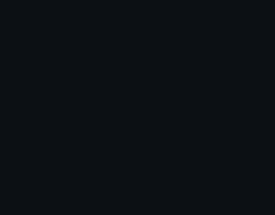
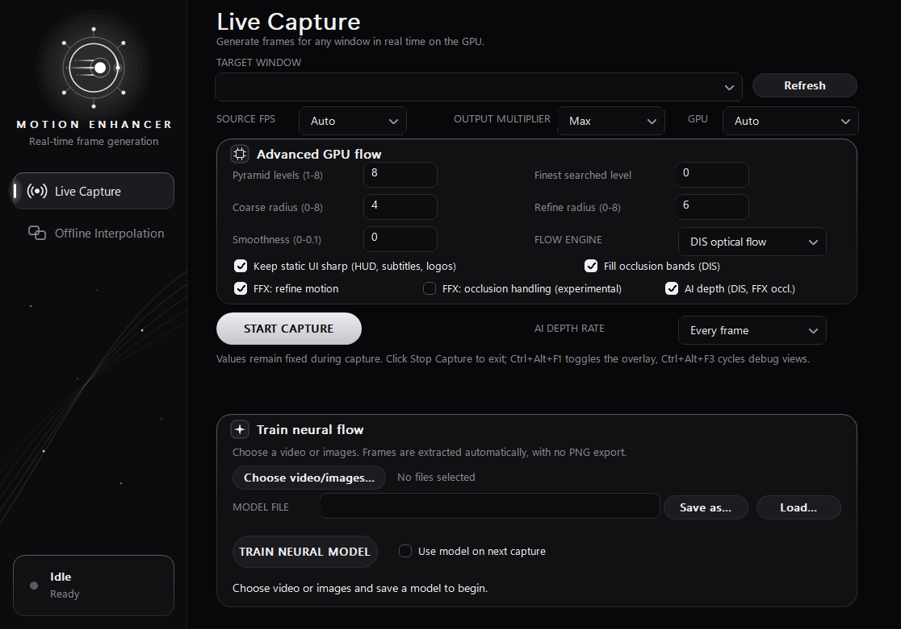
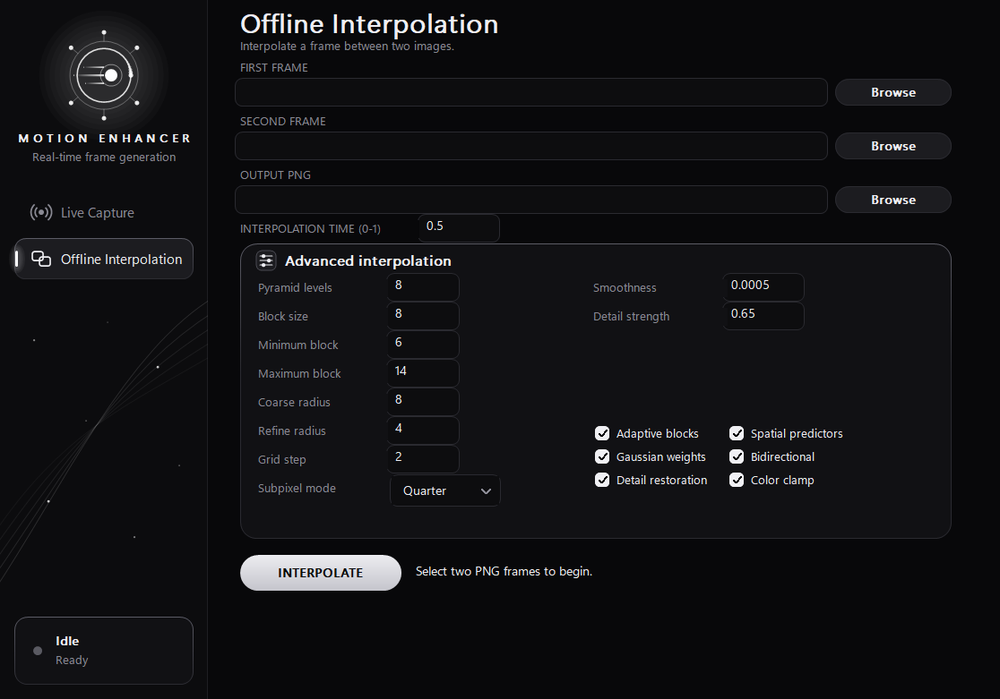
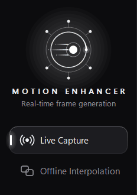

<p align="center">
  
</p>

<p align="center">
  
  
  
  
  
</p>

<p align="center">
  <b>Motion Enhancer</b> raises the frame rate of any window, whether a game, a video or a browser. It generates the frames in between on the GPU in real time and shows them in a click-through overlay.
</p>

<p align="center">
  <a href="#highlights">Highlights</a> &nbsp;·&nbsp;
  <a href="#interface">Interface</a> &nbsp;·&nbsp;
  <a href="#quick-start">Quick start</a> &nbsp;·&nbsp;
  <a href="#how-it-works">How it works</a> &nbsp;·&nbsp;
  <a href="#technical-documentation">Documentation</a>
</p>

<br>

<p align="center">
  
</p>

<br>

<a id="highlights"></a>


<table>
  <tr>
    <td width="33%" valign="top">
      <h3>◉ Any window, live</h3>
      Windows Graphics Capture in, a click-through Direct3D 12 overlay out, paced to your display's refresh. 2×, 3×, 4× or up to the refresh rate.
    </td>
    <td width="33%" valign="top">
      <h3>◈ Motion engines</h3>
      Dense Inverse Search optical flow (the default), AMD FidelityFX Optical Flow, SAD block matching, and a neural estimator you can train on your own footage.
    </td>
    <td width="33%" valign="top">
      <h3>◐ Occlusion-aware</h3>
      Flow in both directions, motion projection and occlusion fill keep a character solid while the camera turns around it.
    </td>
  </tr>
  <tr>
    <td width="33%" valign="top">
      <h3>▣ HUD stays put</h3>
      Static UI (HUDs, subtitles, logos) is recognised per pixel and shown where it is instead of being dragged along by the scene.
    </td>
    <td width="33%" valign="top">
      <h3>◎ AI depth</h3>
      Optional MiDaS depth on DirectML, entirely on the GPU. The nearer surface wins and outlines move with the object in front, as with FSR's depth dilation.
    </td>
    <td width="33%" valign="top">
      <h3>◫ See what it sees</h3>
      <kbd>Ctrl</kbd>+<kbd>Alt</kbd>+<kbd>F2</kbd> saves the last 20 frames you saw from a replay buffer in video memory, and <kbd>F3</kbd> cycles the debug views.
    </td>
  </tr>
</table>

<br>

<a id="interface"></a>


<p align="center">
  
  
</p>

<table>
  <tr>
    <td width="200" valign="middle"></td>
    <td valign="top">
      A monochrome interface with a living emblem. The spark circles the ring and the nodes orbit, the sidebar's lines drift, and the status dot pulses while a capture runs. The navigation highlight glides between pages, buttons fade on hover, and the main button carries a moving sheen. The ambient motion only runs while the window is in front, so it costs nothing while you play.
      <br><br>
      Every engine setting is on the page: pyramid levels and search radii, the flow engine, occlusion handling, static-UI protection, and the AI depth on/off and rate.
    </td>
  </tr>
</table>

<br>

<a id="quick-start"></a>


**1. Build.** You need Visual Studio 2022 with C++ and CMake 3.16 or newer.

```powershell
cmake -B build -G "Visual Studio 17 2022" -A x64
cmake --build build --config Release
```

**2. Run** `build\Release\motion_enhancer.exe`. Pick the target window, leave **Source FPS** on `Auto` and **Output multiplier** on `Max`, then press **Start Capture**.

**3. In the overlay:**

| Keys | Action |
|---|---|
| <kbd>Ctrl</kbd>+<kbd>Alt</kbd>+<kbd>F1</kbd> | Show or hide the overlay |
| <kbd>Ctrl</kbd>+<kbd>Alt</kbd>+<kbd>F2</kbd> | Save the moment you just saw (the frames shown and the game frames they came from) |
| <kbd>Ctrl</kbd>+<kbd>Alt</kbd>+<kbd>F3</kbd> | Cycle the debug views: motion, static UI, occlusion, vector arrows, AI depth |
| <kbd>Ctrl</kbd>+<kbd>Alt</kbd>+<kbd>Esc</kbd> | Stop capture |

From a terminal, `motion_enhancer.exe --list-windows` lists the capturable windows and `--capture-window "<title>"` starts directly. All options are listed under [Usage](#usage).

<br>

<a id="how-it-works"></a>


```
  target window ──WGC──▶ capture ring ──▶ flow queue ──────────────▶ flow ring
                           (dedupe,        DIS · FFX · SAD · neural     │
                            cadence)       AI depth (DirectML) ────┐    │
                                                                   ▼    ▼
  click-through overlay ◀── present queue ◀── motion projection + interpolation
                           (one frame per      (occlusion-aware, static UI kept,
                            display refresh)    timestamp-exact t per frame)
```

Capture, flow and presentation run on separate threads and GPU queues and meet only through fences, so nothing on the way to the screen waits for the flow. Each refresh draws the frame at the exact time between the two source frames that the display needs.

<br>

<a id="technical-documentation"></a>


## Offline CPU interpolator

A C++17 frame interpolation application implementing an **8-level Gaussian pyramid** with **Zero-mean Normalized Cross-Correlation (ZNCC)** block matching motion estimation, multi-candidate spatial predictors (EPZS), 2D Gaussian block weighting, direct quarter-pel bilinear refinement, and **advanced artifact refinement** (Laplacian detail restoration and color bounding box clamping). Interpolation itself is unconditional: no occlusion mask, no confidence weighting, no gating.

### Features & Improvements

- **8-Level Coarse-to-Fine Pyramid**: Builds an 8-level Gaussian image pyramid ($L_0$ to $L_7$) using a 5-tap separable binomial filter $\frac{1}{16}[1, 4, 6, 4, 1]$ and dyadic downsampling.
- **Multi-Candidate Spatial Predictors (EPZS)**: Evaluates hierarchical coarse predictor, spatial neighborhood vectors, and zero vector before searching, eliminating traps in repetitive patterns and local minima.
- **2D Gaussian Block Weighting**: Replaces flat box blocks with 2D Gaussian window weights, concentrating matching metric on block centers and eliminating motion halo / edge-bleeding artifacts.
- **Direct Quarter-Pel & Half-Pel Subpixel Refinement**: Directly maximizes ZNCC in the continuous image domain using bilinear sampling at $0.5\text{ px}$ and $0.25\text{ px}$ candidate steps.
- **Level-Adaptive Block Sizing**: Dynamically scales block sizes across the 8 levels ($14\times 14$ on coarse levels down to $6\times 6$ on fine levels).
- **Color-Guided Edge-Preserving Vector Median Filter**: Prevents foreground motion from bleeding into background by weighting neighbors by RGB color similarity.
- **Unconditional Interpolation**: no occlusion mask, no confidence weighting, no gating. Every output pixel is the time blend of its two warped samples, so nothing can suppress a source frame or fall back to one (the price is a soft ghost where content exists in one frame only).
- **Artifact Refinement Suite**:
  - **High-Frequency Detail Restoration (Laplacian Detail Transfer)**: Injects warped high-frequency detail layers back into synthesized pixels to compensate for bilinear resampling blur.
  - **Local Color Bounding Box Clamping**: Constrains synthesized pixels within the local color bounds of the source samples, preventing ringing spikes and color fringing.
- **Multi-Core Acceleration**: Multi-threaded block matching and synthesis with OpenMP.
- **Zero External Dependencies**: Bundles `stb_image` and `stb_image_write`.

---

## Directory Structure

```
Motion enhancer/
├── CMakeLists.txt              # CMake build script (C++17, OpenMP, MSVC /O2)
├── include/
│   ├── Image.h                # Multi-channel float image container & bilinear sampler
│   ├── Pyramid.h              # 8-level Gaussian pyramid builder
│   ├── MotionVector.h         # Flow field, color-guided median filter, flow visualizer
│   ├── ZNCCMatcher.h          # Coarse-to-fine ZNCC solver with EPZS & sub-pel search
│   └── FrameInterpolator.h   # Bidirectional flow, splatting & detail refinement (offline path)
├── src/
│   ├── Image.cpp
│   ├── Pyramid.cpp
│   ├── ZNCCMatcher.cpp
│   ├── FrameInterpolator.cpp
│   └── main.cpp               # CLI entry point and synthetic benchmark
└── third_party/
    ├── stb_image.h            # Single-header image loader
    └── stb_image_write.h      # Single-header image saver
```

---

## Build Instructions

### Prerequisites
- CMake 3.16 or newer
- Visual Studio 2022 (MSVC) or GCC 9+ / Clang 10+ with OpenMP support

### Building with CMake
```powershell
# Configure build with Visual Studio 2022 x64
cmake -B build -G "Visual Studio 17 2022" -A x64

# Build Release binary
cmake --build build --config Release
```

The executable will be generated at `build/Release/motion_enhancer.exe`.

### Optional AMD FidelityFX Optical Flow

The repository includes AMD FidelityFX SDK v1.1.4 and its `FidelityFX_SC.exe`
shader compiler under `third_party/FidelityFX-SDK-v1.1.4`. The default build
    enables optional native D3D12 Optical Flow without a separate AMD SDK download:

```powershell
cmake -B build -G "Visual Studio 17 2022" -A x64
cmake --build build --config Release
```

The optional FFX integration invokes AMD's supplied `tools/binary_store/FidelityFX_SC.exe`
through the SDK CMake targets. DIS is the default runtime engine; when FFX is
selected it retains one temporal context and falls back to native SAD if
AMD initialization or dispatch fails. SDK v1.1.4
suppresses vectors through temporal frame index 5 after a reset, so a stream
is primed once and every sequential pair thereafter submits only its new
current frame. A changed source texture resets and re-primes the history.
Disable it with `-DMOTION_ENHANCER_ENABLE_FFX_OPTICAL_FLOW=OFF`.

---

## Usage

### Frame Interpolation
```powershell
.\build\Release\motion_enhancer.exe <frame0.png> <frame1.png> <output.png> [options]
```

### Command-Line Options
| Option | Type | Default | Description |
|---|---|---|---|
| `<frame0.png>` | Positional | - | Input image at $t = 0$ |
| `<frame1.png>` | Positional | - | Input image at $t = 1$ |
| `<output.png>` | Positional | - | Output path for interpolated image |
| `--time <float>` | Float | `0.5` | Target intermediate timestamp $t \in (0.0, 1.0)$ |
| `--levels <int>` | Integer | `8` | Number of pyramid levels (default 8) |
| `--block-size <int>` | Integer | `8` | Nominal block matching window size |
| `--search-radius <int>` | Integer | `4` | Refinement search radius per level |
| `--coarse-radius <int>` | Integer | `8` | Search radius at coarsest level ($L_7$) |
| `--grid-step <int>` | Integer | `2` | Grid step: `1` for dense, `2` for $2 \times 2$ grid |
| `--subpel <mode>` | String | `quarter` | Subpixel mode: `none`, `parabolic`, `half`, `quarter` |
| `--no-spatial-pred` | Flag | Off | Disable spatial predictor evaluation (EPZS) |
| `--no-gaussian-weight` | Flag | Off | Disable Gaussian window block weighting |
| `--no-adaptive-block` | Flag | Off | Disable level-adaptive block sizing |
| `--no-bidirectional` | Flag | Off | Disable backward flow estimation |
| `--no-detail-restore` | Flag | Off | Disable high-frequency detail restoration |
| `--no-color-clamp` | Flag | Off | Disable local color bounding box clamping |
| `--detail-strength <flt>` | Float | `0.65` | Detail restoration strength in $[0.0, 1.0]$ |
| `--save-flow <path>` | String | None | Export forward flow visualization to PNG |
| `--test` | Flag | Off | Run synthetic benchmark with ground truth |
| `--list-windows` | Flag | Off | List active desktop windows available for WGC capture |
| `--capture-window <title>`| String | None | Real-time GPU frame interpolation overlay on target window |

### Convolutional estimator options
| Option | Type | Default | Description |
|---|---|---|---|
| `--flow-engine <dis\|sad\|ffx\|neural>` | String | `dis` | Flow engine; `neural` needs a trained model |
| `--gpu-coarse-radius <0-8>` | Integer | `4` | Search radius above the finest level |
| `--gpu-refine-radius <0-8>` | Integer | `6` | Search radius at the finest level |
| `--train-neural <model.bin>` | String | None | Train the estimator on the positional image/video sources |
| `--neural-epochs <n>` | Integer | `24` | Training epochs |
| `--neural-gradient-check` | Flag | Off | Verify the analytic gradient against finite differences |
| `--neural-parity-check <f0> <f1>` | Flag | Off | Verify the shaders compute the trained model's function |

`MOTION_ENHANCER_NEURAL_MODEL` points `--flow-engine neural` and `--neural-parity-check` at a model file.

---

## Real-Time GPU Shader Overlay (WGC + D3D12)

### Graphical Interface

Launch the executable without arguments (or pass `--gui`) to open the native Windows interface. Its theme is monochrome: near-black surfaces, white accents and rounded cards drawn anti-aliased with GDI+. A sidebar holds the emblem, the two pages (**Live Capture**, **Offline Interpolation**; Ctrl+Tab switches) and a status card (Idle / Capturing / Working). It is animated at about 60 frames per second. The emblem's spark circles the ring, its nodes orbit and its glow breathes. The sidebar's lines drift and its points of light twinkle, and the status dot pulses while a job runs. The navigation highlight glides between pages, a new page's title slides in, buttons fade on hover, and the primary button shows a moving sheen. The ambient motion runs only while the window is in front; the transitions always finish. On Windows 11 the window has rounded corners, a dark caption and Segoe UI Variable text. On start a splash plays for 2.6 s while the window is set up behind it. The emblem builds itself: the rings are drawn round behind the spark, the nodes shoot out, the trails sweep in and the core flashes. Then the name settles in letter by letter, and the card fades out as the window fades in. A click or a key skips to the end; `MOTION_ENHANCER_NO_SPLASH=1` turns it off. For offline checks, `MOTION_ENHANCER_SPLASH_FRAMES=<prefix>` writes its frames as PNGs, and `MOTION_ENHANCER_SPLASH_TEST=1` plays it off screen and reports the window's state. For offline UI checks, `MOTION_ENHANCER_GUI_SNAPSHOT=<png>` renders the window off screen into a PNG and exits, without reading the screen; `MOTION_ENHANCER_GUI_PAGE=1` selects the second page and `MOTION_ENHANCER_GUI_TIME=<seconds>` the animation's time.

```powershell
.\build\Release\motion_enhancer.exe
```

- **Live Capture** lists capturable desktop windows and starts the GPU overlay for the selected window. **Start Capture** becomes **Stop Capture** while running; stopping signals the capture process to release its resources and exit normally. Its **Train Neural Flow** panel accepts one or more video files or images (up to 16 files). It samples up to 12 consecutive frames per video for synthetic warm-up, then streams every decoded frame for real-frame training without creating intermediate PNGs. Images can be PNG, JPEG, BMP, TIFF, GIF, TGA, PSD, or any format supported by an installed Windows Imaging Component codec (including WebP/HEIF where available). Choose a `.bin` output path and click Train; the separate process keeps the GUI responsive. If validation accepts the model, the GUI selects the **Neural motion estimator** engine and checks **Use model on next capture**. With no accepted model, the SAD engine remains available. Stopping capture does not train or save weights: the `.bin` is saved when a separate Train run finishes and passes validation. Video formats depend on the codecs installed in Windows (Media Foundation).
- **Offline Interpolation** provides file pickers, interpolation timing, and direct controls for every matcher and synthesis option.

Image input uses stb_image with Windows Imaging Component as a fallback, so the pickers accept common formats such as PNG, JPEG, BMP, GIF, TIFF and WebP; additional formats such as HEIF depend on installed Windows codecs. Alpha is discarded for consistent RGB matching. Interpolated output is still saved as PNG.

For live capture, **Source FPS** defaults to `Auto`, which estimates WGC frame cadence and stabilizes it to `24`, `30`, or `60` FPS. You can select a fixed rate when the content cadence is known. Motion Enhancer accepts source frames at that cadence, then generates timestamp-correct intermediate positions at the display refresh rate.

**Output multiplier** selects `2x`, `3x`, `4x`, or `Max`. The presenter targets source FPS multiplied by this value and caps the result at the display refresh rate. For example, a 30 FPS source produces 60, 90, or 120 FPS at `2x`, `3x`, or `4x`. `Max` retains display-refresh pacing.

Quality presets have been replaced by explicit advanced settings. Live capture exposes pyramid levels, the finest searched level, coarse and refinement radii, and predictor smoothness. Offline interpolation additionally exposes block sizing, grid spacing, subpixel mode, consistency and photometric thresholds, detail strength, and all algorithm feature toggles. Values are validated before processing starts.

The corresponding live command-line options are `--gpu-levels`, `--gpu-min-refine`, `--gpu-coarse-radius`, `--gpu-refine-radius`, and `--gpu-smoothness`. Choose `--flow-engine <dis|sad|ffx|neural>`: `dis` (Dense Inverse Search) is the default, `sad` the previous block matcher, `ffx` is optional AMD FidelityFX Optical Flow, and `neural` requires a trained MNFN model at `MOTION_ENHANCER_NEURAL_MODEL` (see `--train-neural`). The neural engine does not read SAD costs. Older model formats are rejected rather than misread. The active engine is shown at startup and reported per interval in the overlay status line.
Live source cadence is available with `--source-fps <auto|24|30|60>`.
Output multiplication is available with `--multiplier <2|3|4|max>`.

The command-line modes remain available for scripting and automation.

Motion Enhancer can run directly as a real-time GPU-accelerated video/game frame interpolator using **Windows Graphics Capture (WGC)** and a D3D12-first compute/presentation context:

```
[Target App Window (e.g. YouTube, Player, Game)]
              |  WGC (D3D11 surface, timestamp)
              v
    [Capture thread: copy -> slot ring, luma diff, cadence classify]
              |  shared NT-handle texture + capture-ready fence
              v
    [Flow queue: FFX Optical Flow  (or SAD pyramid search)]
              |  flow ring entry + flow fence
              v
    [Frame timeline: media clock = display time - offset - latency budget]
              |  pair (t0, t1), alpha
              v
    [Present queue: InterpolateCS -> flip swap chain, Present(1)]
              |  paced by the DWM compositor clock (one frame per refresh)
              v
    [Click-through overlay window]
```

The real-time path is D3D12-only for compute and presentation; a D3D11 device on the same adapter exists solely to satisfy Windows Graphics Capture's `ID3D11Texture2D` contract. It is organised as five components:

| Component | Thread | Role |
|---|---|---|
| `GraphicsDevice` | – | D3D12 device, a **present queue** and a separate **flow queue**, the D3D11 capture device, and the shared NT-handle textures/fences that order D3D11 → D3D12 access. |
| `CaptureEngine` | capture (producer) | WGC callback only queues frames. The producer thread copies each into a slot ring, runs a sparse GPU luma diff against the newest frame (rejects identical repaints, flags scene cuts), classifies the frame against the source cadence, and submits its flow. |
| `FlowEngine` | capture | AMD FidelityFX Optical Flow (native SAD graph as fallback) into a 16-entry flow ring on the flow queue. Nothing here ever blocks the render thread. |
| `FrameTimeline` | shared | Cadence lock, timestamp regularisation, the media clock, and the adaptive latency budget. |
| `Presenter` | render | 3-buffer flip-model swap chain, `Present(1)`, one command list per refresh, GPU-side fence waits only. |

Release builds compile the HLSL with DXC (`cs_5_0`) into `.cso` artifacts loaded by the D3D12 pipelines; the D3D11 luma-diff kernel is a tiny embedded shader compiled at runtime.

This is not AMD AFMF 2, which remains proprietary driver software. DIS
is the default flow engine. The build also includes AMD FidelityFX Optical Flow;
when selected, it falls back to DIS if it cannot initialize or dispatch (to the
native SAD pipeline with `--no-ffx-refine`). The FFX path supplies a
current-to-previous 8x8 `R16G16_SINT` field of whole-pixel vectors. It is used
as the backward field; the forward field is its negation. Normal capture has no
FFX flow readback or per-frame FFX logging.

**FFX repair (`FfxRepairCS`, on by default, `--no-ffx-repair` turns it off).** FFX regularises its 8×8 field internally, and at a large motion that spreads one surface's vector over its neighbours. Before anything reads the field, each block tries zero motion and the vectors of the blocks 1, 2, 4 and 8 blocks away in eight directions, and takes the one under which its pixels (a 4×4 subsample) match the previous frame best, if it beats its own by 20% and 2 luma levels. Rendered pairs: the sub-pixel game texture +1.5 dB, the fast game pan +1.2, moving objects +0.6, the 1 px pan +0.3, the 88 px pan −0.7, the rest within 0.05 dB. What it cannot repair is a camera turning fast around a still character (96 px/frame): the background just uncovered beside the character has no match in the previous frame at all, FFX's field gives it the character's near-zero motion over about 100 px, and with one field there is no occlusion handling, so the character is drawn two or three times (head 14 dB, against 38 dB with DIS). The two-field FFX mode does not save it either, since both of its fields start from FFX's. For fast third-person camera turns, DIS is the engine to use.

**Variational refinement of FFX's field (`FfxRefine.hlsli`, on by default; `--no-ffx-refine` or the GUI's "FFX: refine motion" disables it).** FFX's vectors are whole pixels on an 8×8 grid. They are spread to every half-resolution pixel (`FfxRefineInitCS`) and refined by minimising a robust energy: brightness constancy, gradient constancy and smoothness of the field, each with a Charbonnier penalty so occlusions and motion edges are not averaged over (Brox et al. 2004; the third stage of the DIS paper, with OpenCV's weights). Each of 3 outer iterations (`FfxRefineIterateCS`) re-warps the earlier frame by the current field, linearises the data terms, and solves for the update with 5 red-black over-relaxation sweeps in groupshared memory on 16×16 tiles, writing the inner 12×12 so tile borders never reach the output. The refined field fills the ring's 2×2 grid. Measured on the 10 rendered 1080p pairs, every pair improves or holds (mean 44.37 → 45.13 dB): sub-pixel pans +1.1 to +1.4 dB, the sub-pixel game texture +2.8 dB, moving objects +0.7 dB. On the third-person 4× test the character goes 22.98 → 23.40 dB and the step-to-step temporal error 3.83 → 3.70. It costs about +0.8 ms per 1440p pair (each outer iteration about 0.25 ms; 5 iterations add up to +0.6 dB more). It only corrects FFX's field locally: what FFX gets wrong by more than a few pixels stays wrong - a brightness change (27.8 dB against DIS's 44.4), a fast game pan (33.4 against 36.1) - and DIS stays ahead on average (47.16 dB). Two safeguards keep the refinement from making FFX's field worse anywhere: each outer iteration may move a vector at most one half-resolution pixel (the linearisation does not hold further, and on real game content an unbounded step threw vectors the wrong way), and at the end a vector is kept only where it matches the two frames (5×5 half-resolution neighbourhood, after the pair's brightness mapping) at least as well as the vector the refinement started from; elsewhere FFX's own vector stands, as DIS keeps its start when Lucas-Kanade ends worse. The rendered pairs are unchanged by them (within 0.15 dB). Separate dispatches per half-sweep measured the same quality at twice the cost. Smoothness weights from 5 to 60 and dropping either data term moved no pair by more than 0.5 dB.

**Occlusion for FFX (`--ffx-occlusion`, or the GUI's "FFX: occlusion handling"; off by default).** FFX gives one field, so `InterpolateCS` cannot tell which frame shows a point beside a moving object. With this option the forward field is refined too: it starts from FFX's field turned around (`F(p) = −B(p + F(p))`, three fixed-point iterations) and is refined with the two frames' roles swapped. Two separately refined fields wander independently wherever the picture leaves them free (on a uniform 1 px pan each spread by ±1.6 px), which pulled the two samples apart and cost 1 dB on pans, so `FfxRefineConsistCS` replaces the forward field by the backward one turned around wherever the two agree within 1–3 px, and keeps the refined forward field only where they disagree. The pans then match the single field exactly. On the third-person 4× test the character gains 0.5 dB (exact silhouette 24.79 → 25.61 dB) and the 1–8 px outside it 0.25 dB, but the background loses 1.0 dB and the step-to-step temporal error rises from 3.70 to 4.45, so it stays off: FFX's field is not accurate enough at edges and in flat regions for the trajectory test to tell occlusion from FFX's own errors. A quarter of a fast-panning background read zero motion in FFX's raw field, in runs of up to 11 blocks on flat areas where every vector matches; filling those from textured neighbours (`FillFlowCS` with the SAD matcher's structure confidence) removed them (21% → 5% of the forward field) but also filled the flat inside of moving objects and of the character with the background's motion (moving objects −1.2 dB, character −0.4 dB), so it is not done either. Disagreement thresholds from 1–3 px to 12–24 px and turning off the candidate search or the trajectory weighting each changed the third-person result by less than 0.2 dB.


### Dense Inverse Search (`--flow-engine dis`, the default)

DIS (Kroeger, Timofte, Dai and Van Gool, *Fast Optical Flow using Dense Inverse Search*, ECCV 2016; OpenCV's `DISOpticalFlow`) is the standard fast block-based optical flow. It replaces SAD's integer block search with a continuous solve, coarse to fine over the same luma pyramid, in both directions:

1. **Patches** (`DisPatchCS`): 8×8 patches every 4 pixels, so they overlap, at every level. Each patch's motion is refined by inverse compositional Lucas–Kanade: the template's gradients and 2×2 Hessian are computed once, and each of up to 12 iterations samples frame1 bilinearly at the current displacement and solves for the update. The cost is the SSD of the two patches' deviations from their own means, so a brightness offset changes nothing, and a gain is removed beforehand by the same pair photometric mapping SAD's packing uses (`Photometric.hlsli`). The answer is continuous: there is no integer window and no subpixel fit.
2. **Densification** (`DisDensifyCS`): every pixel's vector is the average of the patches covering it, each weighted by how well it explains *that pixel* (`1 / max(1, |frame1(x+u) − frame0(x)|)`). On a motion boundary a pixel therefore takes the vector of the side it belongs to, so object edges are not tied to a block grid. The finest level's dense field goes to the flow ring at 2×2 blocks (`DisToRingCS`), against SAD's 8×8, stored as two floats per block (only the vector; SAD's entries also carry confidences). At 4×4, the mean over each block and the bilinear blend between blocks spread an object's motion 2–4 px into the background around its outline, so a character's head or a HUD looked a couple of pixels larger than it is. 2×2 halves that: on the third-person 4× test the 1–2 px just outside the character go from 16.85 to 17.07 dB and the character from 28.96 to 29.06 dB, and the rendered pairs gain 0.0–0.2 dB with none worse. The ring then takes 2 × 16 entries × 7.4 MB at 1440p (236 MB, against 118 MB at 4×4 with four channels), and the flow and interpolation times do not change measurably. What remains outside an outline is mostly the band the camera uncovers or covers, which only one frame shows.

Four things were added to the paper's scheme, each measured with `--gpu-flow-eval` and interpolation PSNR on rendered 1080p pairs with exact motion:

- **A ridge on the Hessian** equal to a patch with a gradient of one luma level per pixel. With a token ridge, a stray gradient threw flat patches tens of pixels, and flat matches flat anywhere, so the error check accepted it (7× SAD's gross errors on flat regions).
- **A step limit of 1 px per iteration**, because the linearisation does not hold further than that.
- **Candidate starts.** Lucas–Kanade only refines and cannot leave the basin it starts in, and the coarser level's flow is a blend or an extrapolation at boundaries. So the coarse flow at the patch centre, the coarse flow one patch away on each side, and zero motion are scored first. A neighbour's start must be 20% better and zero motion 50% better to win, because on flat sky noise otherwise picks them, which cost a landscape pan 2 dB.
- **No refinement at the frame edge.** A patch whose start puts more than a quarter of it outside frame1 keeps its coarse flow, because Lucas–Kanade otherwise slides into the clamped edge smear. On a 41 px pan the 48 px border carried nearly all of DIS's error. Masking the outside samples instead was measured as worse: it biases edge patches toward smaller motion, and the pyramid spread that across an 88 px pan's flat sky.

Measured interpolation PSNR on 10 rendered 1080p pairs (photos, a game-like scene, stripes, moving objects, pans from 1 to 88 px, a brightness change): **DIS 45.74 dB mean against SAD's 44.59**, ahead on 9 of 10. The largest gains are moving objects +2.8, an 88 px pan +2.4, stripes +1.7, a 1 px pan +1.7 and a 47 px pan +1.2. The only loss is −0.35 on a slow pan of the game scene. Per level, textured blocks measure 0.01–0.05 px of error at every level of the game scene and the big pans, against SAD's 0.07–0.3. On the CS2-style sequence (translucent HUD, fast mouse-look pan) the whole frame measures **48.3 dB against SAD's 37.5 and FFX's 47.6**, and the HUD pixels 49.8 dB. The earlier synthetic sequences (HUD over a pan that stops, a fast object over a static texture, the pan alone, an object jumping twice its size per frame) are all equal or better. Cost: 1.87 ms per pair at 1080p against SAD's 1.18 ms (RX 9070 XT).

One thing was tried and removed from interpolation itself rather than DIS: dropping a source sample that lies outside its frame. It is only as good as the vectors at the frame edge, and it cost SAD 0.3–1.5 dB on pans.

### Native SAD matcher (`--flow-engine sad`)

`MotionSearchCS.hlsl` uses ordinary per-pixel SAD: sum `abs(reference - candidate)` over all 64 luma pixels of each 8×8 block, with equal weight for every pixel. Its coarse-to-fine search runs on an 8-level pyramid with a ±6 window. Packed luma stores four bytes per word to reduce memory loads, but the shader unpacks and compares each pixel individually; it does not invoke `msad4`. The vectors go directly into the frame-pair flow field, without a post-processing/refiner dispatch.

**No displacement is ever penalised for its magnitude or for its distance from the predictor.** The matching cost is SAD alone. The smoothness term that used to be subtracted from every candidate's score was doing two jobs: it broke ties between near-equal minima (useful) and it pulled real minima back toward the coarse level's guess (not useful — a 16 px object read 13 px at every level because of it). It is replaced by `RankKey`, which buckets the score by one luma level and, *within a bucket only*, prefers the candidate nearest the coarse predictor. A candidate a full luma level better always wins whatever its distance, so nothing is held back; inside one bucket the measurement cannot separate the candidates anyway, and choosing consistently is what stops a block flickering between two equally good alias peaks. Removing the penalty *without* that replacement cost 12 dB at 1080p, so the two changes only make sense together.

### Convolutional estimator (`--flow-engine neural`)

A trained convolutional flow estimator, in `NeuralFlow.h` / `NeuralFlow.cpp` (inference reference), `NeuralFlowTrain.cpp` (training), `LearnedFeaturesCS.hlsl` (feature extractor) and the neural branch of `MotionSearchCS.hlsl` (cost volume and soft-argmax). 238 weights, file magic `MNFN`.

- **Feature extractor**: 3×3 → 6 channels with ReLU, then 3×3 → 2 channels plus a learned gain on the next coarser level's features, then `tanh`. A 5×5 receptive field with a hidden nonlinearity. Built once per captured frame and cached per capture slot.
- **Cost volume**: for each candidate displacement, 16 samples at stride 2 inside the 8×8 block give the squared feature distance, summarised as six descriptors — the block mean, the centre mean and one mean per quadrant. The quadrants cost no extra reads and are what let the head notice that a block straddles a motion boundary, where one mean cannot separate "matches everywhere badly" from "matches half the block perfectly".
- **Head**: 6 → 8 ReLU → 1, times a learned temperature. **Appearance only.** No geometry is an input.
- **Estimate**: the softmax-weighted mean of every displacement in a dense 9×9 window — differentiable, which is what makes the whole thing trainable.
- **Anchors**: the same ten candidates the classical centre stage scores (predictor, eight parent neighbours, zero), ranked on learned cost with the same bucketed tie-break. Reach comes from the pyramid.

**Capacity is in the extractor, not in the channel count.** The matcher reads 16 samples of both feature maps for every one of 81 candidates, so a third or fourth channel multiplies the bandwidth of the pass that is already bandwidth-bound at 1080p. The extractor runs once per frame per pixel, so depth there is nearly free.

**Training** — `--train-neural <model.bin> <video.mp4|image.png> [more files...]`, `--neural-epochs <n>` (default 24). Supervised on frames warped by known piecewise-constant flow fields (a global translation plus up to two independently moving rectangles), so the truth is exact except on blocks that straddle a region boundary, which are excluded rather than supervised toward a value no estimator should produce. Optimised with Adam on the **analytic gradient** of a Charbonnier end-point error, cosine-decayed. Every pyramid level is supervised against the truth it is responsible for with the coarser level's predictor fed in **detached**, so the recursion is never differentiated through but every level trains on the predictor distribution it actually meets at inference.

Two tests keep the four implementations of this one function honest, and both are worth running after any change to either side:

- `--neural-gradient-check` compares the analytic gradient with a central finite difference, one representative weight per group. It replays the detached parent flow and parent features into both evaluations, so the numeric side differentiates the same truncated objective; without that it disagrees by 25–60% for a correct gradient. The trainer runs it before training and refuses to start if it fails.
- `--neural-parity-check <f0.png> <f1.png>` compares the shaders with the CPU reference on a real pair: the level-0 feature map, then each pyramid level's flow given the GPU's own features *and* its own predictor. It reports two populations separately — blocks where both sides searched the same window, which must agree to ~1e-3 px and is the bound with teeth, and blocks whose near-tied anchor tipped, which cannot be bit-equal because the host compiles with `/fp:fast` and the GPU reassociates freely. This is the test that found a clamp-ordering bug (the shader clamps a sample into the level *before* adding the displacement; letting `Image::get` clamp afterwards samples a different candidate pixel on every block that overhangs a level edge) and a radius-schedule mismatch between the CPU and the GPU.

**This engine is not the default and on the synthetic suite it does not beat the SAD engine.** The architecture is deliberately small enough to fit the latency budget alongside everything else, and what limits it now is capacity, not the training objective. Train it on your own footage before judging it: the model shipped by a training run on synthetic sources has only ever seen those statistics.

- **Pyramids per frame, not per pair**: each captured frame's luma pyramid is cached in its capture slot. Native SAD also caches packed luma; the neural path instead computes and caches coarse-to-fine learned feature maps. FFX keeps the previous frame's pyramid the same way.
- **Scalar SAD**: the candidate window is staged as packed luma words in shared memory, then each of its 8×8 pixels contributes its absolute luma difference. Black pixels participate normally; zero is not a mask value.
- **Learned features**: in neural mode, the image filters generate appearance/structure features before motion inference. SAD and its edge diagnostic are not computed or supplied to the neural network.
- **No temporal prediction**: every pair is estimated from its own two frames. The previous pair's flow used to be offered as a candidate and used as the tie-break reference; it was removed because a vector about a frame that is gone kept steering blocks after the motion under them changed, which showed as ghosting. On the synthetic sequences (a HUD over a pan that starts and stops, a fast object over a static texture, the same pan without HUD, an object jumping twice its size per frame) every case measured equal or better without it, the fast-object case by +1.2 dB.
- **Filling what was never measured (`FillFlowCS`)**: a block only constrains the component of its vector along which its own content changes — a flat block constrains neither, and a vertical line constrains x while saying nothing about y. On a noise-like background that is a rounding error (89% of blocks measure both axes exactly). On a page of charts and anti-aliased text, **77% of blocks measure nothing at all**, and they used to emit whatever the inheritance chain handed them, which starts at zero: 9.7% of blocks correct, 57% wrong by more than 8 px, the wrong ones overwhelmingly `(x, 0)`. Bilinearly blending that zero against a textured neighbour's real vector is what dragged the background beside text and smeared glyph edges. The matcher now reports a per-axis confidence (the diagonal of the block's luma structure tensor) and a fill pass writes the unmeasured components from the neighbours that did measure them, weighted by their confidence, their distance, **and how close their vector is to this block's own** — the last term is what stops a small object's flat interior being flooded by the larger, equally confident background around it. Measured components pass through; nothing is penalised, vetoed or zeroed. It runs after *every* level, because the filled field is the next level's predictor — and therefore the CPU reference and the trainer run it too, so the neural weights are fitted inside the recursion they are deployed in.
- **Candidates**: ten centres — the parent predictor, the eight neighbouring parents (EPZS) and zero — are each scored once on plain SAD, then one ±radius window is searched around the winner. Zero is in that list so a coarse level that locked onto a wrong vector can always be abandoned, and it must win by a full luma level, so ties go to motion rather than to a stall. There is no second window: zero used to get a whole ±8 window of its own whenever it fell outside the first, which on a camera pan is *every* block and cost 2.1 ms of 6.6 at 1080p. Blocks with too few edge samples pick among the centres only. (Until the temporal predictor was removed, the predictor slot itself was mis-indexed and scored a parent block three columns away instead; it is now the predictor.)
- **Ambiguity (repeating/dense textures)**: near-equal SAD minima are alias peaks, and picking between them arbitrarily makes the warp pop. Candidates within one luma level of the best are not separable by this measurement, so the one nearest the coarse predictor wins. The key is packed into one float so the *group-wide* reduction resolves ties too; resolving them per thread left the choice to whichever lane happened to hold the maximum. No subsequent filter changes or zeroes the estimated vectors.
- **Radius**: `--gpu-refine-radius` at the finest level (default **6**) and `--gpu-coarse-radius` above it (default **4**), tapered to +-4 and +-3 at the two coarsest levels.
  - Six at the finest level, not eight, for speed: the matcher spreads a window's candidate columns over its 64 threads, so a span of 13 (radius 6) is one pass of the inner SAD loop per thread and a span of 17 (radius 8) is two. **The cost is a step function of the radius**, and 8 sits just past the step for no measured gain - at 1080p, 8/8 took 4.67 ms and 6/6 takes 3.06 ms with equal or better PSNR everywhere. Keep every level's span at or below 13.
  - Four above it, for accuracy. A coarse level's pixels each cover a large area of screen, so a wide window there is a long way to look for a match the level cannot really resolve - and on periodic content it finds one. The bar-chart page (bars on a 46 px pitch, text rows on 20 px) locked onto those aliases and handed them down as predictors: **18.80 dB at radius 6 against 47.69 dB at radius 3**, and the live symptom was artifacts around text. Four also improved the 160 px motion case and the pan case. It costs 4.6 dB on the synthetic `circle` test, whose sinusoidal background is diagonally translation-invariant and whose 21 px texture period makes -5 an alias of +16 - the case this README already says not to judge objects on; the noise-background equivalents are unchanged.
  - Reach still compounds down the pyramid: 6 + 4*(2+4+8+16+32) + 4*64 + 3*128 = 896 px over eight levels, and a global -48,-24 px motion is found exactly.
- **Subpixel**: the window returns a whole number of pixels, and a parabola through the SAD at the winner and its four axis neighbours recovers the fraction for five more block comparisons (~3% of the window). The fit is used only where those three samples are convex. A browser scrolls by a fractional number of pixels per frame, and rounding every block to the nearest pixel turns a smooth scroll into a shimmer.
- **Brightness changes (`FrameStatsCS`, `PackLumaCS`)**: SAD on raw luma fails completely when the brightness changes between the two frames (an exposure change, a fade, a flash): every candidate is off by the change and the cheapest one is whatever happens to be brighter. A 12% gain plus 10 levels measured 64.7 px of error at the finest level and was wrong at every level. Each frame's whole-frame luma mean and deviation are measured once on a small pyramid level, and for each pair both frames' SAD bytes are mapped onto the pair's common brightness and contrast, which cancels any global gain and offset exactly (finest level 0.026 px, 29.4 → 44.0 dB). Motion changes the statistics too, by up to 1.8 levels of mean on the test pans against 25 for the real change, and on smooth content a correction that small moves a match by pixels (compensating every pair cost a pan 4.8 dB). So the mapping fades in between 6 and 12 levels of mean difference and is exactly the identity below: every ordinary case measured bit-identical. Local transforms (luma minus a local mean, or divided by local contrast) also fixed the brightness case but cost 0.3–1.5 dB on ordinary content, because they make a pixel's byte depend on its neighbours, and those differ across a moving object's edge between the frames. An equiangular (V) subpixel fit, the textbook estimator for SAD, was also tried and measured 0.12 dB worse than the parabola.

`tools\make_flow_tests.ps1` regenerates the 320×240 verification pairs. Measured on an RTX 3050 Ti laptop, scalar SAD: the −12 px and −10 px global shifts 50.42 and 51.52 dB PSNR, the (16,8) cel and textured-circle cases 31.89 and 35.56 dB, a global −48,−24 px motion found exactly.

**1080p flow latency** (best of 40 back-to-back submissions; a single timestamp on a laptop GPU is meaningless because the clocks ramp):

| case | SAD | FFX | neural |
|---|---|---|---|
| static background, (16,8) object | 2.88 ms | 2.65 ms | 2.21 ms |
| global pan, (−12,−6) | 2.89 ms | 2.65 ms | 2.22 ms |

The SAD engine was 4.41 ms and 6.59 ms before the radius and zero-window changes above. Judge quality on PSNR rather than the centre-block vector: in the `cs` and `cel` cases that block sits inside a flat cel-shaded interior where no block-local vector is recoverable and the number is whatever propagated into it.

**Measure vector accuracy per pyramid level with `--gpu-flow-eval <prefix>...`.** For each `<prefix>_a.png`, `_b.png` and `_flow.bin` (int32 width, int32 height, then float32 dx, dy per pixel: the true forward motion), it reads the forward field back at every level, both the matcher's raw answer and the filled field the next level inherits, and reports the error in that level's pixels. It only scores blocks whose footprint moves uniformly and stays in frame, and it reports textured blocks (both eigenvalues of the structure tensor measurable) separately, because a wrong vector on a flat region or along an edge is invisible in the interpolated frame. `MOTION_ENHANCER_FLOW_EVAL_DUMP=1` writes every block to `<prefix>_blocks.txt`. On rendered 1080p pairs with exact motion, game-like texture measures 0.1–0.2 px at every level for 7 and 41 px pans. The large remaining errors are on smooth renders, along the direction of curved edges, where the motion is not measurable.

**Measure cross-pair behaviour with `--gpu-offline-sequence <prefix>`, not with a frame pair.** FFX keeps its own history and the static-UI evidence is carried from pair to pair, and every single-pair path breaks that chain: `--gpu-offline-prev` primes only one pair back, and `MOTION_ENHANCER_BENCH_ITERS` re-submits the same pair, which breaks the chain after the first iteration. Anything that accumulates, latches or feeds back across frames is invisible to them. The sequence mode replays `<prefix>_f000.png, _f001.png, …` as consecutive pairs through one engine and reports PSNR per step against `<prefix>_m000.png` and so on. Build sequences where motion **starts and stops**, not only constant-velocity ones — a steady scroll is the easiest possible case for anything carried across frames, and the old temporal predictor hid a 15 dB loss on the frames after a stop that way. `MOTION_ENHANCER_SAD_DEBUG=1|3|5|6` exposes matcher stages (edge counts, parent flow, skip window, skip centres).

**Check the GPU is not power-limited before trusting any timing.** On this laptop, unplugging it drops the GPU to a 25 W enforced limit where it bounces between 210 MHz and its 2100 MHz maximum and never holds boost; the same unchanged FFX path measures 2.63 ms on AC and 4.6 ms on battery. `nvidia-smi --query-gpu=clocks.sm,clocks.max.sm,enforced.power.limit,pstate --format=csv` says which state you are in. Keep one engine you have not modified in the table as a control — a change that appears to slow down code you did not touch is the machine, not the code.

Shader staleness used to be a trap here and is now fixed: the compiled `.cso` copy is a POST_BUILD step on `motion_enhancer_shaders` as well as on the executable, so editing only an `.hlsl` reaches `Release\shaders` instead of leaving the previous shader next to the binary.

### Pacing and Synchronization

**Output clock.** The render loop is woken by the DWM compositor clock (`DCompositionWaitForCompositorClock`), i.e. once per vsync; the swap chain's frame-latency object is used only as non-blocking back-pressure. A phase-locked loop on the wake times predicts the display time of the frame being rendered, so consecutive frames are exactly one refresh apart even when the wake-up itself jitters, and it resyncs only on a genuinely missed refresh.

**Media clock.** Source frames carry WGC timestamps $t_i$. The timeline tracks the minimum capture offset $O$ between wall clock and $t$, and maps a predicted display time $T$ to media time

$$m = T - O - D$$

where $D$ is a latency budget that starts at one source period plus two refreshes and adapts: it grows whenever a needed pair was not ready (starvation) and decays while pairs have been ready with margin. For the pair $t_0 \le m < t_1$ the blend factor is $\alpha = (m - t_0)/(t_1 - t_0)$. Because $m$ advances with the wall clock, a missed refresh skips media time instead of slowing it, and motion always plays at 1x.

**Source cadence.** The period is estimated from every non-duplicate WGC arrival (mean of the middle half of the last 16 intervals) and locks when three quarters of them agree. Once locked, a frame arriving far off the cadence grid is held for 0.7 periods: if a newer frame supersedes it (a UI repaint between video frames) it is dropped, otherwise it is accepted late and the grid resyncs. Two frames closer than 0.3 periods are treated as one (the later replaces the earlier). Accepted timestamps are regularised onto the grid with a slow phase correction, which removes the ±8 ms jitter of a 24 fps video repainted at 60 Hz. Identical repaints (fewer than 0.05 % of sampled pixels changed) never enter the timeline; pairs classified as scene cuts are presented as a hard switch rather than interpolated.

**GPU ordering.** All ordering is on the GPU: the present queue waits on the capture-ready fence for both source frames and on the flow-queue fence for the pair, then interpolates. Shared capture textures are simultaneous-access resources read through implicit COMMON-state promotion, so no transition barriers are recorded on them from either queue. Slots and flow-ring entries are recycled only after the fences of every queue that read them have passed.

**Synthesis (`InterpolateCS`).** Flow is one vector per 8×8 block, and each pixel's warp is the bilinear blend of the four nearest block vectors. Apart from the static-UI and trajectory rules below, that is the whole pass — no occlusion mask, no confidence, no gating, no per-pixel choice between candidate vectors, so interpolation is never suppressed and no pixel can snap to a source frame.

**Sharp sampling (`SampleSharp` in `Synthesis.hlsli`).** A warp lands between texels almost everywhere, and a bilinear read there averages the neighbours, so each generated frame came out softer than the real frames around it, by an amount that changes with the motion. That shows as the image pulsing between sharp and soft. Both frames are therefore read with a Catmull-Rom filter (five bilinear taps), clamped to the four texels around the sample so it cannot ring or overshoot; at a texel centre (no motion or a whole-pixel one) it returns that texel exactly, as before. `UiMaskCS` reads the same way, so its damage test still sees the exact output. Measured on the 10 rendered 1080p pairs: mean PSNR 45.78 → 47.12 dB, none worse (sub-pixel game texture 40.25 → 43.68, sub-pixel pans +2.6 to +3.3 dB, fast game pan 35.26 → 36.01, moving objects 41.64 → 41.93). The fine detail of the generated frame (mean |Laplacian| against the true midpoint) rises from 56-59% to 75-79% on game textures and from 87-91% to 94-102% on photographic pans. On the synthetic sequences that move only by whole pixels it cannot help, and costs up to 0.1 dB where a vector is slightly off (a sharp but displaced sample errs more than a blurred one). It costs roughly +0.05-0.1 ms per generated frame at 1440p (RX 9070 XT; `MOTION_ENHANCER_BENCH_ITERS` now also times the interpolation pass). Two other synthesis changes were measured and not kept: weighting the four block vectors by colour similarity at motion edges (-1.8 dB on moving objects, worse everywhere), and judging a trajectory's error per frame instead of scaled by t (no measurable change).

**Static UI (`UiMaskCS`, on by default, `--no-ui-mask` or the GUI checkbox to disable).** A HUD, subtitle or channel logo sits still while the content under it moves, and the block field there belongs to the moving content, so a plain warp drags the UI along and smears copies of it into the background. After each pair's flow, a full-resolution pass compares, per pixel, how far the warp would move it (the *damage*: > 16 levels at t = 0.5, tested with the exact warp `InterpolateCS` uses, shared through `Synthesis.hlsli`) with how much the pixel itself changed between the two frames. A pair is evidence when the damage is clear and the pixel's own change is under a third of it. Opaque UI does not change at all; translucent UI (CS2's panels, a crosshair outline, antialiased glyph edges, a 90% radar ring) changes only by the see-through part of the background, which a plain "did not change" test can never accept; a moving background fails, because its change *is* the texture the warp follows. An unchanged pixel next to confirmed UI also joins while the scene under it moves, which fills the middles of glyphs and bars that the warp alone cannot tell from more of the same UI. The evidence is a small count carried from pair to pair in the flow ring (R8, one texture per entry). A pixel is treated as UI only after three such pairs in an unbroken frame chain, and **any other change takes it out at once**: HUD that moves, slides or animates is interpolated like everything else, because holding a changing pixel blends its old and new content on top of each other. A merely static pixel (a still background, a flat sky) never accumulates evidence, because the warp leaves it alone, so nothing that could move across it is ever hidden. For confirmed UI, `InterpolateCS` shows the pixel where it is (the time blend of the two frames at that pixel) and drops any warped sample that lands on UI, taking that pixel from the other frame, which stops the background dragging HUD copies along. With no confirmed UI the output is bit-identical to the plain warp.

Measured on synthetic 640×360 sequences with exact midpoints (a world panning 8 px/frame then stopping, a sprite passing under the HUD, text/health bar/2 px crosshair/score HUD): HUD pixels **22.9 → 30.5 dB** mean, everything else unchanged or slightly better, every confirmed pixel exact, 0 false positives on the HUD. On sequences with no UI at all (a fast object over a static texture, the same pan without the HUD, an object jumping twice its size per frame), PSNR is equal or better. The only pixels flagged there are static background bordering moving regions, which the warp would otherwise have dragged. The pass costs no measurable flow time at 1080p (1.21 vs 1.22 ms best of 600, RX 9070 XT), plus 16 × width × height bytes of memory. `--gpu-offline-sequence` prints the confirmed fraction per step and writes `<prefix>_ui000.png …`. On a CS2-style sequence (960×540, a mouse-look pan at 28 then 10 px/frame then still, translucent panels with antialiased text, an outlined crosshair, a rotating radar in a 90% ring, a killfeed appearing, a swaying viewmodel), HUD pixels go 47.50 → 48.62 dB with FFX and 34.72 → 35.62 dB with SAD, the rest of the frame unchanged; the outlined crosshair and the text come out without the ghost copies the plain warp leaves. Not covered: the interior of a translucent panel is warped with the background behind it (correct for the background, so a panel's own soft edge can still smear), UI that animates in place is interpolated in the pairs it changes, and a 1-pixel ring around UI was tried for the rim and removed - it held the moving edge of real content still wherever static scenery bordered it.

**Occlusion: each sample comes from the trajectory that closes, weighted by how well it closes.** Next to an object moving against the background (a third-person character the camera orbits, a target tracked during a fast turn, the viewmodel), the background point a pixel needs is hidden behind the object in one of the two frames. In that frame no point of the field actually travels to the pixel at time t: the fixed point `p + t·F(p) = pixel` has no solution, and the warp used to end on the object and blend it in at full weight. The result was a half-transparent second (or third) copy of the character's head and body beside it, as wide as the relative motion. Two things fix it, both geometric rather than photometric, and both in two-field mode only (FFX's forward field is its backward field negated):

- **Closest trajectory.** Across an object's edge the field ramps smoothly from one motion to the other over several pixels. In that ramp neither side's trajectory closes, so both samples are wrong. So besides the plain warp's vector, the field's vectors 8 px and 24 px away in each axis direction are tried as trajectories (`v → pixel − s·v`), and one replaces the plain vector if it closes at least 0.25 px better (residual `s·|flow(pixel − s·v) − v|`). In uniform motion every candidate is the same vector, so nothing can switch. At an edge the winner is the vector the field itself confirms at the place it points to. In an occlusion band two candidates often close almost equally, and choosing one per pixel there left the band as blocky fragments of both sources; where the best trajectory closes worse than half a pixel, the runner-up's sample is blended in by how close the tie is (weight exp(−((r₂ − r₁)/1 px)²)). On the third-person 4× test that cut high-frequency noise in the 1–12 px outside the character by 12%, raised that band 0.1 dB and the character's exact silhouette 0.14 dB, and left the temporal error unchanged; the rendered pairs are unchanged or better (moving objects +0.16 dB). Blending every near tie removed more noise (−17%) but raised the whole frame's temporal error 3%.
- **Trajectory weight.** Each sample is then weighted by `1 / (1 + (r/5)²)`, where `r` is its residual in pixels. An occlusion leaves 10–25 px and drops to a few percent; the field inside a moving object is only accurate to a pixel or two, so a 1 px scale tipped ordinary moving objects to one frame (−0.3 to −0.5 dB), while 5 px keeps the plain blend there.

Measured with DIS on a third-person orbit sequence (960×540, background 50 px/frame and ground 70 px/frame against a character near the centre whose texture turns 4 px/frame), the whole frame goes from 26.95 to 27.49 dB, and the doubled head and body are gone. On a target tracked during a 20 px/frame turn the enemy goes from 20.64 to 21.12 dB with a single head. The 10 rendered pairs measure 45.74 → 45.78 dB mean (moving objects +0.30, nothing worse than −0.04), and the CS2-style sequence 48.28 → 48.37 dB. A round trip (`F(p) + B(p + F(p)) = 0`) was tried first and is the wrong test: it asks whether the sampled point is visible in both frames, and the object the bad sample lands on is visible, it just isn't this pixel. Confirmed UI pixels are held in place only where at least one neighbour in their 3×3 neighbourhood is confirmed too, because isolated confirmed pixels are noise and holding them speckles the image. The bar was 4 of 9, which a 1-2 px stroke - HUD text, a thin icon outline - never reaches: those were warped with the background and broke into pixel fragments (HUD +1.2 dB with FFX, +0.5 dB with DIS on a translucent-panel text HUD over a panning background). What is left at an occlusion is the uncovered background itself: its motion is not measurable from both frames, so the band beside a fast object can still show smeared background (no longer a copy of the object). **Motion projection (`ProjectClearCS`, `ProjectSplatCS`, `InterpolateCS`; every two-field pair).** Deciding per output pixel which vector to follow is what left the band beside a moving character as blocky fragments: the field there is a blend, and neighbouring pixels decided differently. Frame generation decides it the other way round. AMD FSR 3 frame interpolation splats its motion vectors to the interpolated frame with atomics and a priority, builds a disocclusion mask per direction and blends its game-vector and optical-flow results by colour similarity; Softmax Splatting (Niklaus & Liu, CVPR 2020) uses the brightness-constancy error as the priority when there is no depth. Here, for every output frame, every block of both fields writes itself at the place it occupies at time t into a 2×2-cell projection (`InterlockedMin` of priority and block index), with priority = 16 × round-trip error (px) + brightness error (levels): a point hidden in the other frame fails the round trip by the relative motion and loses to whatever covers it, even where both are flat. Each output pixel then takes, per frame, the winner of the four cells around it whose block lands nearest the pixel, refined by one trajectory step on the bilinear field while that stays within 3 px. A frame with nothing landed within one cell does not show the point and its sample is left out. A winner is trusted fully; down-weighting winners by their priority distrusted exactly the background still visible at time t that is covered later. Projection alone painted wrong vectors wherever they landed (a hair-coloured ring beside a head) and lost 0.7 dB on the character, so where both frames have a block and their samples disagree by more than 2 levels, the trajectory search's pair is computed too and the two are blended by how well each pair's samples agree (weight exp(−(Δ/8)²)); elsewhere the search is skipped, which made the pass cheaper than before (about 0.6 against 0.75 ms per generated frame at 1440p). Measured on the third-person 4× test against the occlusion fill alone: the band beside the character 21.58 → 22.06 dB, the character 26.53 → 26.85 dB, the rest of the frame 30.55 → 31.14 dB, step-to-step temporal error 3.03 → 2.74, high-frequency noise in the band −16%. Rendered pairs against the start of this work (no fill, no projection): the 41 px pan 51.19 → 54.03, the fast game pan 36.05 → 37.98, the 88 px pan 47.24 → 48.16, the sub-pixel game texture 43.83 → 44.58, stripes 48.98 → 49.98 dB, the moving-objects pair 42.29 → 41.06 and the sub-pixel pan 52.01 → 51.74; the tracked enemy 21.2 → 24.8 dB. Not done: inpainting of pixels neither frame shows (FSR 3 fills those from a colour pyramid); here they keep the trajectory search's blend.

**AI depth (`DepthService`, `DepthEstimator`, `DepthInputCS`; `--ai-depth` or the GUI's "AI depth", which is ticked by default; experimental).** MiDaS v2.1 small (Intel ISL, MIT licence, `third_party/ai-depth/models`, converted with `third_party/ai-depth/models/optimize_midas.py`: the model's own ImageNet normalisation is removed because `DepthInputCS` already normalises, which before this was applied twice and blurred the depth into blobs; the zero Pads and BatchNormalizations are folded into the Convs; and the weights and Resizes are FP16 with FP32 input and output. Each step was checked with onnxconverter-common and the ONNX checker) runs through ONNX Runtime 1.24.4 with the DirectML 1.15.4 execution provider on the program's own D3D12 device, on a compute queue of its own. Everything stays on the GPU: once per captured frame the flow list writes the network's input (`DepthInputCS`: averaged down to 256×256, normalised, planar) and copies it into a D3D12 buffer bound straight to the network (ONNX Runtime I/O binding of DirectML allocations); the network's queue waits on the GPU for that flow list, and a compute queue then maps the output to "nearness" (`DepthFinishCS`: percentile-normalised inverse depth from a 1024-bin histogram, 0 far .. 1 near). The CPU only orders the work (about 0.2 ms per frame). The network takes about 1.3-1.6 ms per run on an RX 9070 XT (`--depth-test` "GPU path", idle clocks). Nearly all of that is fixed per-layer cost: about 100 small layers, each a dispatch and a barrier. A 128×128 input is only 0.1-0.3 ms faster, and DirectML graph capture saves about 3%. By default the network runs on every new frame. The GUI's "AI depth rate" (or `--ai-depth-every N`, 1-4) runs it on every N-th frame instead, and a frame between borrows its neighbour's depth. Every 2nd frame costs about 0.65-0.8 ms per frame. The presenter takes a frame's depth only once it is complete, so nothing on the way to the screen waits for it. It is used in the motion projection (`ProjectSplatCS`): the priority gains 32 × (1 − nearness), so where two blocks of one field land on one place and both fit, the nearer one wins, as with a real depth buffer (DAIN, CVPR 2019, does the same with network depth). Two-field pairs only (DIS, FFX `--ffx-occlusion`). Measured: the effect is negligible. With the fixed model (every second frame) it was +0.01 dB (DIS) and 0.00 dB (FFX occlusion) on the user's real frames; before that it was ±0.01 dB on the user's real frames, the CS2-style test and the fast-turn head test, and even ranking the projection by depth alone moved the CS2-style test only 0.07 dB. The projection's winner decides few pixels in the end, because the trajectory search and the sample-agreement blend after it decide most of them. The depth itself is meaningful on the user's game (sky and far rocks far, the ground near, the character's head and torso as a nearer shape). Since the normalisation fix the character is a sharp silhouette with head and arms, not a blob. At 256×256 its edges are still several screen pixels wide. **Edge dilation** (`DepthDilateCS`, as AMD FSR's Reconstruct & Dilate does with the game's depth): before the projection, each field whose frame has depth is dilated at outlines. A block whose nearest-to-camera neighbour (3x3, one block away) is clearly nearer than itself (by more than 0.02 nearness) takes that neighbour's vector, so an outline moves with the object in front and not with a blend or the background behind it. On the user's real frames it changed about 1% of the pixels, along the character's outline and in some grass. There it was better in every pair that changed: DIS 13 of 13, FFX occlusion 10 of 10, by +0.02 dB in those regions with speckle unchanged. A reach of two blocks was mixed (8 better, 10 worse). A depth-guided occlusion fill was also tried (the farther candidate wins in a band hidden in the other frame). It was worse wherever it acted, by 0.4-1.7 dB, and was removed. `MOTION_ENHANCER_DEPTH_REPORT=1` prints each frame's depth time; `--depth-test in.png out.png` runs the network on one image (timing and the depth map). onnxruntime.dll is delay-loaded: without it, or without the model, the program runs as before.

**Occlusion fill (`OcclusionFillCS`, DIS, on by default; `--no-occlusion-fill` or the GUI's "Fill occlusion bands" turns it off).** Beside a moving object the estimated field is a blend - patches straddle the outline, so the vector fades from the object's motion to the background's over several pixels, much wider next to a flat region that matches any motion - and the per-pixel trajectory choice made from it left the band as blocky fragments of both sources. Once per pair, on the 2×2 ring grid, each block whose vector fails the round trip (out along it and back along the other field, more than 1.5 px off) takes the vector of a confirmed block within 24 px: one that also survives the round trip from here and matches the picture if there is one (the block is visible in both frames and only had a blended vector), otherwise - the block is hidden in the other frame - one under which it would be hidden, from the block that looks most like it in this frame. Geometry alone cannot pick between the background's and the occluder's vector there (both fail the round trip, and both fail the picture), and taking the nearest smeared a character's colour 15-20 px into the background; the band looks like the background beside it. Measured on the third-person 4× test: the band 1-12 px beside the character 20.75 → 21.59 dB, the character 25.93 → 26.53 dB, the rest of the frame 29.94 → 30.55 dB, step-to-step temporal error 3.58 → 3.03 and the worst step 20.17 → 16.37; a target tracked during a 20 px/frame turn 21.2 → 24.7 dB. Rendered pairs: stripes +0.9, pans +0.2 to +0.5, game textures +0.2 to +0.3, the sub-pixel pan −0.3, and the moving-objects pair −2.3 dB: a smooth shape's trailing edge keeps a clean trajectory in the frame it left, so the interpolation still blends some of it into the filled band. Requiring a hidden block to land on a surface both fields agree on halved that loss and half the gains too, and a wider picture window (4×4, 8×8 px) was no better. Cost about 0.2 ms per 1440p pair. An earlier version measured the camera's motion along the frame border in a single thread group and ran several full-resolution passes, and was removed as too heavy.

Two things about *where* the field is read, both of which were wrong and are worth +0.7 dB on the SAD engine at 1080p:

**The field is read along the trajectory, not at the destination.** `ForwardFlow` is defined on frame0's grid, so the point visible at pixel $x$ at time $t$ is the $p$ with $p + t F(p) = x$ — a fixed point, not a direct lookup. Reading $F(x)$ and stopping there asks the field for the motion at the point's *destination*: on a 16 px motion at $t = 0.5$ that samples 8 px away, so the vector an object's own block voted for gets applied to the background beside it and vice versa, which is what tears object edges. Two Picard iterations converge wherever the field is Lipschitz below $1/t$, and each costs four loads of a texture 64× smaller than the frame.

**The two engines do not use the same field convention, and the warp has to know.** The SAD and neural graphs run two independent searches, so `forward` is on frame0's grid and `backward` on frame1's. FFX only estimates current→previous, so its "forward" is exactly `-backward` and *both* are indexed on frame1's grid — there is a single trajectory, and solving the frame0-grid fixed point for a field that is not on frame0's grid is simply the wrong equation. It cost 1.3 dB on a pure global shift until `FlowEngine::Entry::singleField` carried the distinction; `setInterpolationConstants` is now the only way to fill those constants, because a site that sets the block size and the timestamp by hand and forgets the convention produces a plausible-looking frame from the wrong maths.

Three sharper schemes were built here and removed, and are worth not rediscovering. **Per-pixel vector selection** (every pixel scoring the surrounding blocks' vectors photometrically and keeping the best) sharpens boundaries — 1–16 dB on the synthetic object cases — but has no answer where the photometric error is degenerate: in blown highlights and flat saturated regions every candidate scores alike, so noise picks the winner per pixel. On real footage (a fast arm crossing a clipped lantern) that tore the frame into 8 px chunks with the highlight smeared along the arm. **Choosing the visible side per pixel in occlusion bands** (from forward/backward round-trip errors, or any other local test) flips chaotically right at the boundary, where both sides score alike, and shreds the uncovered band. **Splatting the block vectors to their time-$\alpha$ positions** (resolving overlaps with an `InterlockedMin` on a packed coverage/speed key) is the textbook answer to both, gained 5–6 dB on pans and 2 dB on the object case, and still did not fix the artifacts on real footage — which is the evidence that what fails there is upstream of synthesis.

Diagnosing that: `MOTION_ENHANCER_DUMP_FRAMES=<prefix>` writes the first eight frames the capture *accepts* (duplicates already rejected — exactly the frames the flow runs between) as `<prefix>_000.png`, `_001.png`, … Consecutive files are a real pair, so `--gpu-offline <a> <b> out.png --save-flow flow.png` replays offline precisely what the live path saw, and the flow visualization shows whether the vectors were already wrong before anything was synthesised.

Diagnostics: `MOTION_ENHANCER_PACING=1` logs every presented frame (mode, predicted display time, media time, pair, alpha); `MOTION_ENHANCER_D3D_DEBUG=1` enables the D3D12/D3D11 debug layers and prints validation messages with the 2-second status line; `MOTION_ENHANCER_DUMP_FRAMES=<prefix>` saves the accepted capture frames as described above.

### Hotkeys in Overlay Mode
- `[Ctrl+Alt+F1]`: Toggle overlay visibility (Hide / Show)
- `[Ctrl+Alt+F2]`: Save the moment you just saw into `captures\<date-time>\` next to the executable: the last 20 frames exactly as presented (`shown_007_g2-3_t0.54.png`: generated between `game_002` and `game_003` at t = 0.54; `shown_008_g3_real.png`: a real frame) and the last 8 game frames they were made from (`game_000.png …`, to replay offline). The presenter keeps them in a replay buffer in video memory all the time (one copy per refresh, about 0.05 ms, ~410 MB at 1440p), so pressing the key captures the frames *before* it and nothing on the way to the screen waits for the save; the PNGs are written one by one in the background (a few seconds; `[Capture] saved …` when done).
- `[Ctrl+Alt+F3]`: Cycle the live debug views (the console prints which one is on). Each view greys the picture and marks the top-left corner with the kind of frame on screen — green a real frame, magenta a generated one, yellow a frame shown with no interpolation (held, a scene cut, startup), which is where stutter comes from — followed by one white dot per view number.
  1. **Motion**: the motion each pixel was interpolated along; hue = direction, strength = speed (full at 48 px per frame).
  2. **Static UI**: yellow where HUD evidence is building, green where a pixel is confirmed (light green where it is too isolated to be held).
  3. **Occlusion**: red where the earlier frame's sample does not reach the pixel and is weighted down, blue the same for the later frame.
  4. **Vector arrows**: the estimated motion (earlier → later frame) as one arrow per 16 px, drawn at a quarter of its length and capped at 14 px so arrows never overlap (a capped one keeps its direction), coloured by direction as in view 1; a white dot is a cell moving less than 2 px.
  5. **AI depth**: the AI depth of what is on screen (needs "AI depth" on, and DIS or FFX occlusion handling for it to be used), from dark blue (far) through cyan, green and yellow to red (near); a generated frame shows its two frames' depth blended at its time. Grey where there is no depth: AI depth off, or that frame's depth not finished yet.

  `MOTION_ENHANCER_DEBUG_VIEW=<1..5>` renders the same views in `--gpu-offline` and `--gpu-offline-sequence`.
- `[Ctrl+Alt+Esc]`: Exit overlay and stop capture

### Quick Start for Real-Time Capture

1. **List all open desktop windows:**
   ```powershell
   .\build\Release\motion_enhancer.exe --list-windows
   ```

2. **Launch real-time overlay on your application:**
   ```powershell
   # Capture browser / YouTube window
   .\build\Release\motion_enhancer.exe --capture-window "Brave"

   # Capture media player or game window
   .\build\Release\motion_enhancer.exe --capture-window "VLC"
   ```

---

## Example Commands

### 1. Real-Time GPU Window Capture & Interpolation
```powershell
.\build\Release\motion_enhancer.exe --capture-window "YouTube"
```

### 2. Offline Interpolation with Visualizations
```powershell
.\build\Release\motion_enhancer.exe frame0.png frame1.png interpolated_0.5.png `
    --time 0.5 `
    --levels 8 `
    --save-flow flow.png
```

### 3. Built-in Ground Truth Verification Benchmark
```powershell
.\build\Release\motion_enhancer.exe --test
```
Estimates motion across 8 pyramid levels, validates subpixel precision against ground truth ($\Delta x = +16\text{ px}, \Delta y = +8\text{ px}$), and outputs PSNR and execution time.
