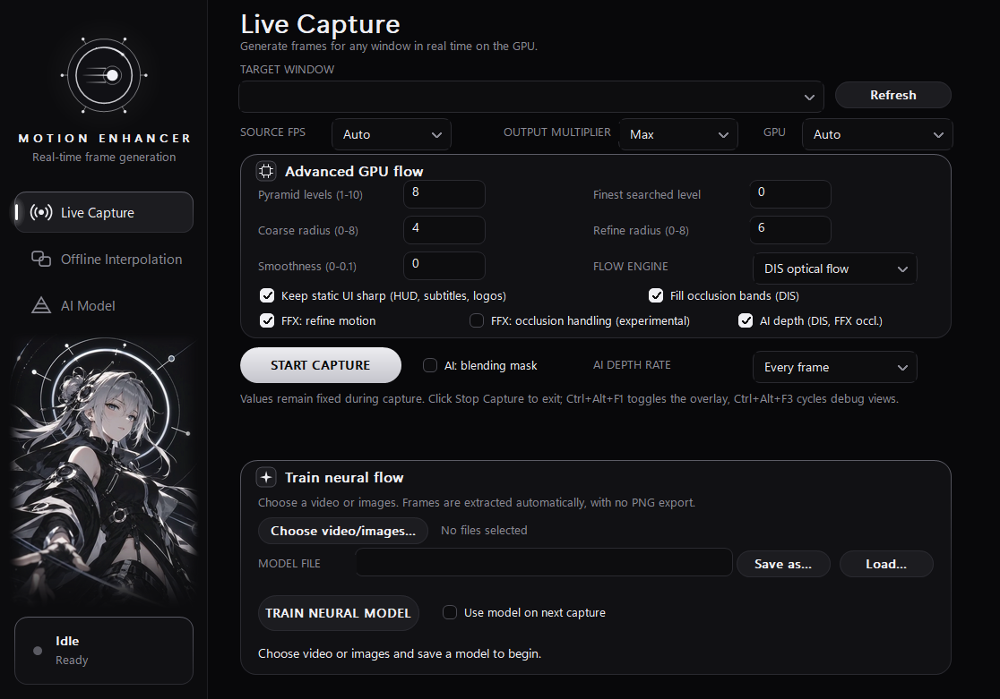
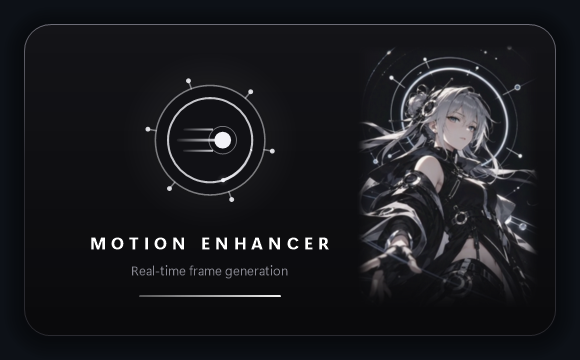

# Character branding

The user-supplied celestial-character clip is used as silent decorative artwork
below the native GUI's navigation and beside the startup splash. The original
orbital icon, app name, controls and status card remain separate and unchanged.
The installer/trainer UI and motion-estimation/training code are not changed.





`packaging/assets/character-atlas.png` contains a feathered portrait with a
one-second baked crossfade at the loop boundary: 216 frames, 24 fps, nine seconds.
The animation now uses the clip's native frame rate without speeding up playback.
It is embedded in the EXE and decoded once to approximately 57 MiB of CPU-side
premultiplied pixels. There is no audio, runtime video decoding, new rendering
thread, DirectML session or capture-pipeline work. Animation follows the existing
GUI clock, which stops while the window is not foreground or is minimized.

The source MP4 stays untouched outside the repository. Its SHA256 and generated
atlas metadata are recorded in `packaging/assets/character-atlas.json`; this is
provenance, not a claim about redistribution rights to the supplied artwork.
Normal builds need only the checked-in PNG and generated header.

To regenerate using the trainer's Python environment:

```powershell
tools\ai-train\.venv\Scripts\python.exe tools\make_character_assets.py "path\to\character.mp4"
```

To check the assets and real GUI without reading the desktop or starting capture:

```powershell
tools\ai-train\.venv\Scripts\python.exe tools\test_character_brand.py --exe "path\to\motion_enhancer.exe" --artifacts "path\to\screenshots"
```

## Verified preview

`build-character-preview/Release/motion_enhancer.exe` is a separate Release build
with the native flow backends, runtime DLLs and 29 freshly compiled shaders.
Its `models/` folder is deliberately empty: no existing model or installed
executable was replaced. The trainer is not bundled in this UI preview.

Asset/hash/alpha/padding/loop tests passed, as did native off-screen rendering
on all three pages, native 24 fps frame selection, the nine-second loop,
splash fade/handoff and existing
Explorer/window-icon checks. Native portrait compositing matched the generated
artwork to a mean error of 0.220/255. All 26 protected file hashes matched after
verification, including the source clip, orbital assets, existing executables
and checked checkpoints/models. No capture or training job was started.
