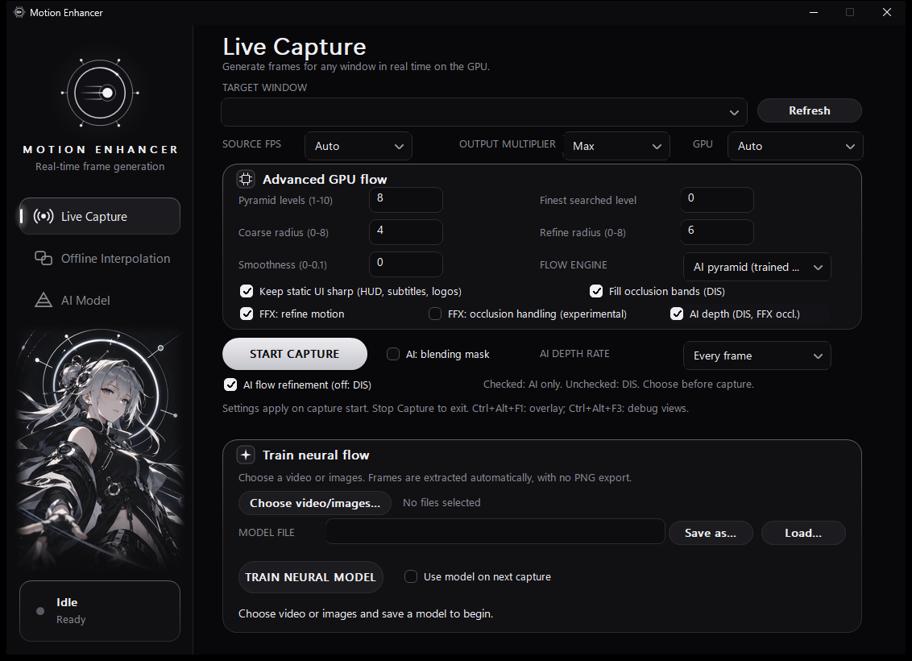

# Character branding

The user-supplied celestial-character clip is used as silent decorative artwork
below the native GUI's navigation and beside the startup splash. The original
orbital icon, app name, controls and status card remain separate and unchanged.
The artwork is separate from motion estimation and training. The earlier
AI-refinement support has also been restored to the main build.


`packaging/assets/character-atlas.png` contains a feathered portrait with a
one-second baked crossfade at the loop boundary: 216 frames, 24 fps, nine seconds.
The animation now uses the clip's native frame rate without speeding up playback.
It is embedded in the EXE and decoded once to approximately 57 MiB of CPU-side
premultiplied pixels. There is no audio, runtime video decoding, new rendering
thread, DirectML session or capture-pipeline work. Animation follows the existing
GUI clock, which stops while the window is not foreground or is minimized.

The source MP4 stays untouched outside the repository. Its SHA256 and generated
atlas metadata are recorded in `packaging/assets/character-atlas.json`; this is
provenance, not a claim about redistribution rights to the supplied artwork.
Normal builds need only the checked-in PNG and generated header.

To regenerate using the trainer's Python environment:

```powershell
tools\ai-train\.venv\Scripts\python.exe tools\make_character_assets.py "path\to\character.mp4"
```

To check the assets and real GUI without reading the desktop or starting capture:

```powershell
tools\ai-train\.venv\Scripts\python.exe tools\test_character_brand.py --exe "path\to\motion_enhancer.exe" --artifacts "path\to\screenshots"
```

## Main build

Run `build-project/Release/motion_enhancer.exe`. This is the only active build
folder and includes the verified 24 FPS character animation, native flow
backends, runtime DLLs and 29 compiled shaders. Future trainer exports target its
`models/ai_flow.onnx`.

The main build also contains **AI flow refinement (off: DIS)**. Select **AI pyramid
(trained model)** on Live Capture to enable the checkbox. Checked selects
integrated AI only; unchecked selects the backbone plus DIS. The blending mask
is independent. Choose before capture; stop/restart to apply a different mode.

With the user's approval, the active models are now exact copies of the four
refinement-capable files supplied in Documents. Previous models were backed up;
the source files and training checkpoints remain untouched. See
[restoration verification](validation/ai-refinement-restored-2026-10-30.md).



The old character/refinement preview folders and `build-ffx-local` were moved
intact into a dated archive under `backup/`; their different models and captures
were not deleted. The previous main runtime and trainer settings were backed
up there too. See [consolidation verification](validation/single-build-2026-10-30.md).
The installation at `C:\MotionEnhancer` was not replaced.

Asset/hash/alpha/padding/loop tests passed, as did native off-screen rendering
on all three pages, native 24 fps frame selection, the nine-second loop,
splash fade/handoff and existing
Explorer/window-icon checks. Native portrait compositing matched the generated
artwork to a mean error of 0.220/255. The initial isolated-preview verification
matched all 26 protected hashes; consolidation separately verifies the retained
models, checkpoints, dataset index, installation and archived files.
No capture or training job was started.
